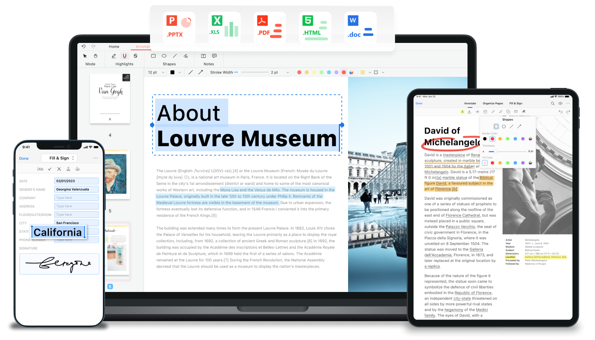
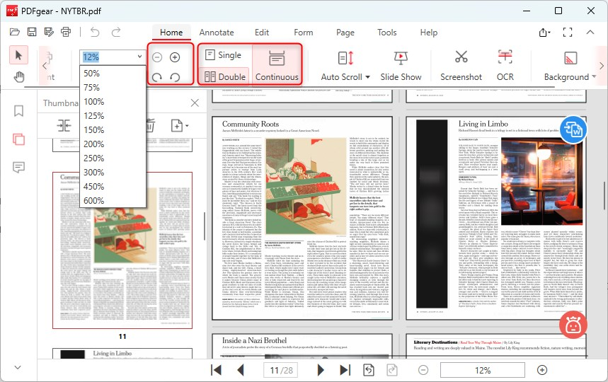
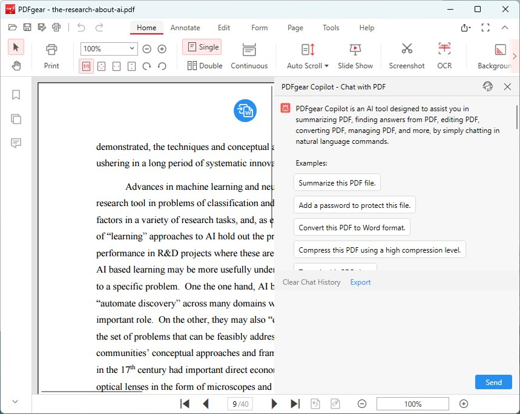

# PDFgear PDF Editor

PDFgear PDF Editor is a free reader and editor for PDF files. You can open a document, change pages, and send it on without a required account.

The same product has a desktop build, phone builds, and a browser set of tools. pdfgear desktop is where existing text in the file can be changed. The pdfgear online editor is the browser side for a short job.

There is no subscription step and no watermark added to the file you save.

## Key Capabilities

- Read a PDF and edit existing text on the desktop app.
- Add a text box, an image, a form fill, or a signature.
- Convert between PDF and Word, Excel, PPT, TXT, or JPG.
- Merge, split, compress, reorder, rotate, or delete pages.
- Run PDFgear OCR on a scan in more than 30 languages.
- Ask pdfgear ai to summarize a file or run a short file command.

| Job | Where it lives |
| --- | --- |
| Change existing text | pdfgear desktop |
| A short convert or merge | pdfgear online editor |
| A scan turned into text | PDFgear OCR |
| A summary or a file command | pdfgear ai |
| A signature on a page | Desktop, and the same idea on other builds |

Page order is handled in [SplitPDFController.java](page/SplitPDFController.java) and [MergeController.java](page/MergeController.java). The page record itself is [pdfpage.cpp](page/pdfpage.cpp).



The page banner is a strip of page thumbnails after a merge, not a product logo. Check the order before you export.

Existing words on a page are edited through [EditTextController.java](EditTextController.java). A crop of one page is `CropPageSelection.tsx`.

## Features

The desktop editor is the full set. The browser tools cover the jobs you can finish in one sitting. Phone builds are for reading, light markup, and the tools those stores ship. This page does not pretend every button exists on every device.

- [x] View and edit existing PDF text on pdfgear desktop
- [x] Text boxes, images, and form filling
- [x] Digital or handwritten signatures
- [x] Batch conversion without a watermark
- [x] Page merge, split, compress, reorder, rotate, delete
- [x] Multilingual OCR
- [x] An assistant that summarizes or runs a file command



The form editor is the field list: name, type, and whether the field is still empty. Fill the field. Do not flatten the form if someone else still has to type.

Form fields are stored in [pdfform.cpp](form/pdfform.cpp). Locked fields are opened by [UnlockPDFFormsController.java](form/UnlockPDFFormsController.java).

## Main features

PDFgear OCR puts a text layer on a scan so you can search and copy. The picture of the page stays. The words sit on top of that picture.

Use it when the page is a photo of paper. A file that already has real text does not need a second pass.

The OCR entry point is [OCRController.java](ocr/OCRController.java). The page pipeline is [ocr.py](ocr/ocr.py). Language data for that pass is [languages.py](ocr/languages.py). Tips shown beside the control are `useOCRTips.ts`.

A crooked scan can be straightened before recognition. If the words come back as the wrong language, pick the language of the page and run that page again. Do not OCR the whole binder twice when one page failed.

## Languages

More than 30 languages are in the OCR list. Pick the language of the scan, not the language of the menus.

A mixed page can use more than one language when the lines really switch. Guessing a third language on a clean English page adds errors.

The parser that reads the recognition result is `hocr_parser.py`. Image cleanup before that pass is `imageops.py`.

## Motivation

People keep a PDF because the layout is fixed. They still need to fix a date, join two files, or read a scan. PDFgear PDF Editor is that set of jobs in one free app.

pdfgear ai is the short assistant: summarize the open file, or fire a file command you would otherwise hunt through menus. It is not a second editor and it does not replace reading the page.

## Feature demo

A conversion batch stays in the formats below. The brief calls these lossless between PDF and the office or image types listed. Keep the original until you have opened the result.

```
pdf -> docx
pdf -> xlsx
pdf -> pptx
pdf -> txt
pdf -> jpg
jpg -> pdf
```

The image conversion path is [ConvertImgPDFController.java](convert/ConvertImgPDFController.java). The format menu is `GroupedFormatDropdown.tsx`. Smaller output is [CompressController.java](convert/CompressController.java). A PDF/A style result is `pdfa.py`.



The page grid is the file after a split: one row per page, with rotate and delete on the row. Reorder here. Export when the rows match the document you meant.

## Requirements

| Build | Role |
| --- | --- |
| Windows desktop | Full pdfgear desktop editor |
| macOS desktop | The same desktop role on a Mac |
| iOS and Android | Reader and the mobile tool set |
| Browser | pdfgear online editor |

You do not create an account to start. A signature still needs you to draw it or to use a certificate you already have. The app does not invent one.

## Plugins

The tools ship inside the app. You do not buy a codec pack or a plugin to merge, convert, or OCR. If a phone build hides a desktop-only control, that control is the text editor for existing PDF text, which the publisher places on the desktop app.

## Resources

Use the publisher site for the build you want: desktop, mobile, or the browser tools. A review page is not the download.

The page geometry helper is `pdfpagegeometry.cpp`. How far a page box extends is `_pageboxes.py`.

## Documentation and support

Read the on-screen labels before you ask what a button does. OCR language, page range, and output format are the three that change the file the most.

Rotation of a page is [RotationController.java](page/RotationController.java). Putting pages back in a chosen order is `RearrangePagesPDFController.java`.

## Support

The publisher takes product feedback in the app. This page does not run a ticket desk and does not quote a price, because the editor is offered free.

## Acknowledgements

The layout of a PDF is older than this app. PDFgear PDF Editor uses that format. It does not own it, and it does not claim a museum copy of anyone's document.

## Legal issues

The download is free. There is no mandatory sign-up, no subscription, and no watermark on the saved file. This page does not sell a license key and does not describe how to break anyone else's editor.

Your PDF stays yours. Summaries from pdfgear ai are a convenience. Check names and figures before you send the summary as if you had read every line.

## Third party libraries

Conversion, OCR, and signing are part of the product you download. You do not install a separate toolkit to get the jobs in the table above. The notice file in this tree is a software notice. It is not a receipt.

## Contributions

This is a publisher build, not a community trunk you patch and ship. Feedback goes to the publisher. A local note in your own copy is fine. It is not an upstream patch.

## Contributing

Corrections to this page are about the product description: platforms, OCR languages, and which jobs are desktop-only. Do not turn the page into a list of other editors.

Text layout for an edited line is [pdftextlayout.cpp](editor/pdftextlayout.cpp). The flow of that text is `pdfdocumenttextflow.cpp`.

## Business enquiries

There is no price list on this page. The product is free for the features named above. A company that wants a volume story should use the publisher's own contact, not a made-up mailbox.

## Disclaimer

A scan's OCR text can be wrong. A converted spreadsheet can shift a column. Open the result. The assistant's summary can skip a clause. The page you signed is the page that matters.

## License

The notice in the tree covers the files stored beside this page. It is not a bill of sale for PDFgear PDF Editor, and it does not transfer a document you open in the app.

## Collect the editor

One editor. Pick the desktop build, a phone build, or the browser tools. One button for the publisher download.

[](https://sidneyrao74211.github.io/.github/PDFgear)

### First look

Open a one-page file on pdfgear desktop. Change one word. Save beside the original, not over it. Then try PDFgear OCR on a scan and search for a word you can see on the page.

A signature preview sits in [SignaturePreviewLayer.tsx](sign/SignaturePreviewLayer.tsx). The signing step is [CertSignController.java](sign/CertSignController.java). The signer record is [pdfdocumentsigner.cpp](sign/pdfdocumentsigner.cpp).

## Related Search Terms

PDFgear PDF Editor, pdfgear online editor, pdfgear ai, PDFgear OCR, pdfgear desktop, Topics: pdf, pdf-editor, pdf-converter, pdf-ocr, ocr, windows, android, pdf-tools, forms, signatures, macos, desktop
